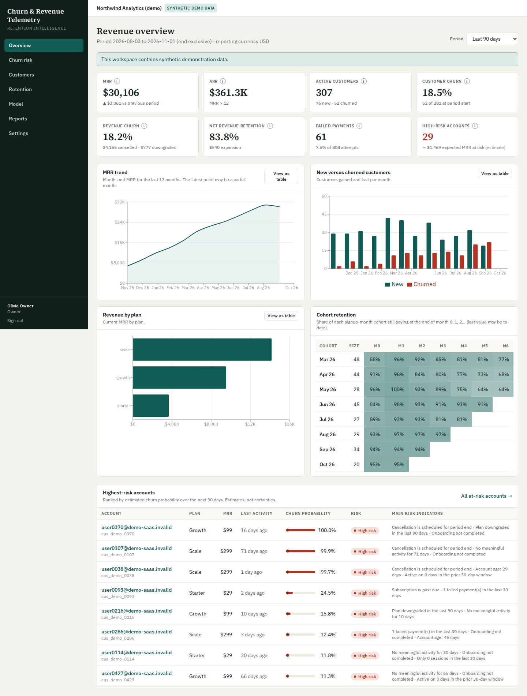
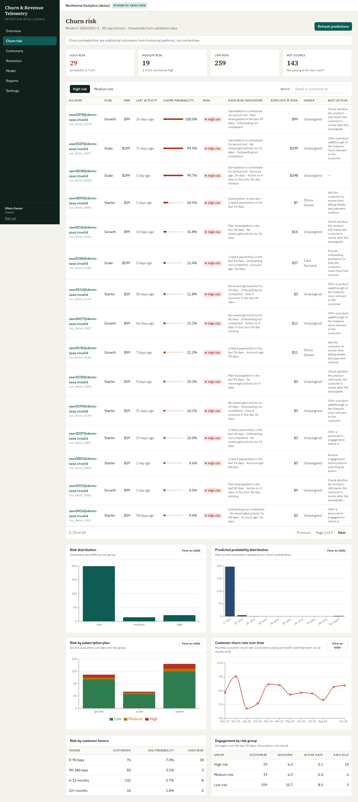
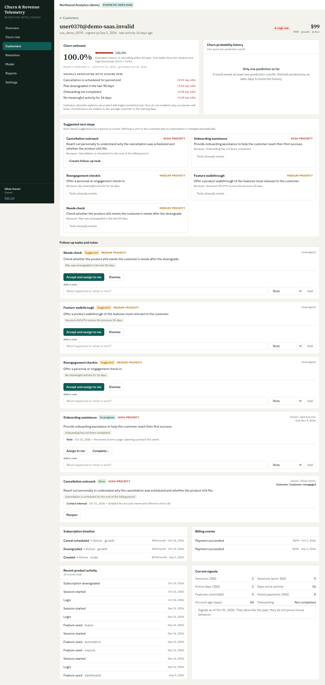
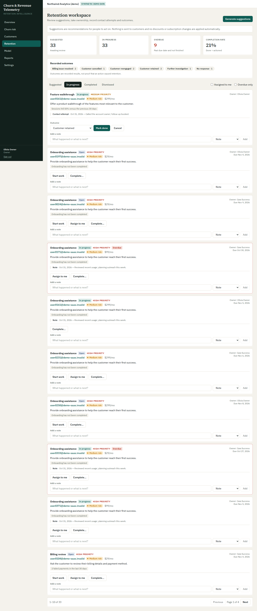
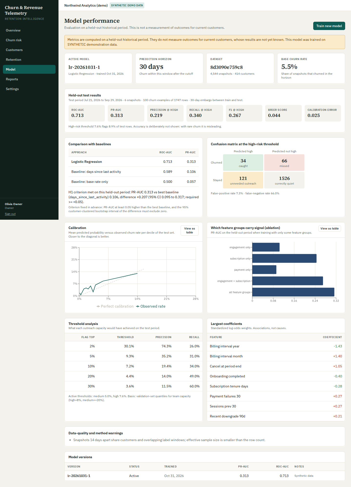
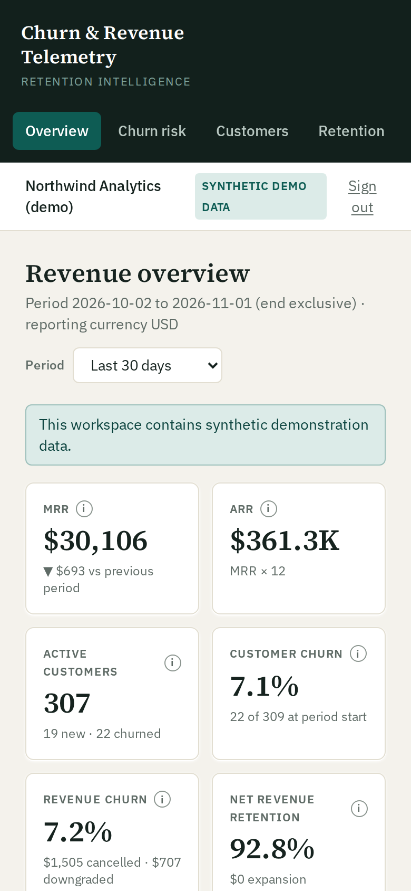

# SaaS Churn & Revenue Telemetry Predictor

A working, tested analytics platform that turns **Stripe billing events**, **product usage telemetry** and **CSV imports** into
recurring-revenue metrics, **explainable churn-risk estimates** (Logistic Regression) and a **human-run retention workflow**.

> **Honesty notes.** The bundled demo workspace uses **synthetic data** produced by a simulator that plants the relationships the
> model learns, so demo metrics demonstrate the pipeline, not real-world predictive power. Churn probabilities are statistical
> estimates, never certainties. The platform recommends actions for people to take; it never contacts customers, issues refunds,
> or changes subscriptions on its own. See [docs/known-limitations.md](docs/known-limitations.md).
[](https://gitdiagram.com/nikhil0074-dev/saas-churn-revenue-telemetry-predictor?utm_source=readme&utm_medium=badge)

 **Architecture diagram**

## Screenshots (demo workspace, synthetic data)

| | |
|---|---|
|  **Revenue overview** |  **Churn risk** |
|  **Customer detail with explanation** |  **Retention workspace** |
|  **Model performance** |  **Mobile layout** |

More: [login](docs/screenshots/01-login.png) · [customers](docs/screenshots/04-customers.png) · [reports](docs/screenshots/08-reports.png) · [settings](docs/screenshots/09-settings.png)

## What is implemented

| Area | Implemented |
|---|---|
| Auth & tenancy | Registration, login/logout (server-side token revocation), password reset, 4 organization roles + platform-admin flag, per-organization data isolation tested on every resource |
| Billing | Verified Stripe webhooks (official library), idempotent receipt, out-of-order safe, background processing, retry of failed events, Stripe sync (API), CSV import, audit trail |
| Telemetry | Authenticated ingestion API (per-organization key, single/batch up to 500), schema validation, duplicate handling, rate limiting |
| Revenue analytics | MRR, ARR, customer churn, gross/net revenue churn, NRR, growth, payment failure rate, plan revenue, signup-month cohorts, MRR bridge (documented policy in [docs/metrics.md](docs/metrics.md)) |
| Machine learning | Label generation, leakage-safe features, chronological split with embargo, Logistic Regression pipeline, two baselines, bootstrap significance test against a pre-registered criterion, calibration, ablation, checksum-verified artifacts |
| Explainability | Per-customer log-odds contributions, sign-sanity filtering, rules engine for recommendations, model/dataset versioning on every prediction |
| Workflow | Suggested actions, assignment, notes, contact attempts, outcomes, overdue tracking, completion rate |
| Reporting | 5 reports with date filters, JSON preview, CSV export with formula-injection protection |
| Ops | Alembic migrations (verified on SQLite and PostgreSQL), health/readiness endpoints, structured errors, request IDs, Docker/Compose |

## Quick start (macOS / Linux)

Requires Python 3.11+ and Node 20+. No database server, Stripe account or Docker needed.

```bash
python -m pip install -r backend/requirements-dev.txt
python scripts/seed_demo_data.py            # SQLite DB + synthetic data + trained model (~15 s)
cd backend && python -m uvicorn app.main:app_factory --factory --port 8000      # API  -> http://localhost:8000/docs
# second terminal
cd frontend 
npm ci 
npm run dev                                          # UI   -> http://localhost:5173
```

Sign in with `owner@example.com` / `DemoPass2026!` (also `analyst@`, `csm@`, `viewer@example.com`, same password).
Demo data is generated relative to *today*; re-run the seed script to refresh it.

**Windows:** see [docs/windows-setup.md](docs/windows-setup.md) (PowerShell script included).
**Docker:** `docker compose up --build`, then `docker compose run --rm seed`, open http://localhost:8080 (PostgreSQL-backed; see the note in [docs/deployment.md](docs/deployment.md) about what was and was not executed).

## Using your own data

1. Create a workspace on the sign-in page.
2. **Settings → CSV import** (customers, subscriptions, events, payments; formats in [docs/data-dictionary.md](docs/data-dictionary.md)) *or* connect Stripe test mode ([docs/deployment.md](docs/deployment.md#stripe)).
3. Create an ingest key in Settings and send product events to `POST /api/v1/events`.
4. **Model → Train new model.** Training refuses to run (and says why) until there are enough labeled snapshots; until then every screen works in *rules-based mode*.
5. **Churn risk → Refresh predictions**, then **Retention → Generate suggestions**.

## Tests

```bash
cd backend && python3 -m pytest -q --cov=app --cov=../ml/churn_ml    # 172 tests (backend + ML), 97% line coverage
cd frontend && npm run typecheck && npm test                          # 47 tests
python3 e2e/ui_e2e.py                                                 # real-browser flow (needs servers, see docs/testing.md)
```

Latest recorded run: **172 backend/ML tests passed (also against PostgreSQL 16), 47 frontend tests passed, browser E2E passed** — details and
what is *not* covered in [docs/testing.md](docs/testing.md).

## Repository layout

```
SaaS Churn & Revenue Telemetry Predictor/
│
├── backend/
│   ├── app/
│   │   ├── api/
│   │   │   ├── routes/
│   │   │   ├── dependencies.py
│   │   │   └── router.py
│   │   │
│   │   ├── services/
│   │   │   ├── customer_service.py
│   │   │   ├── prediction_service.py
│   │   │   ├── analytics_service.py
│   │   │   └── model_service.py
│   │   │
│   │   ├── db/
│   │   │   ├── models/
│   │   │   ├── repositories/
│   │   │   └── session.py
│   │   │
│   │   ├── schemas/
│   │   ├── core/
│   │   ├── middleware/
│   │   └── main.py
│   │
│   ├── alembic/
│   │   └── versions/
│   │
│   ├── tests/
│   │   ├── unit/
│   │   ├── integration/
│   │   ├── api/
│   │   └── e2e/
│   │
│   ├── requirements.txt
│   ├── alembic.ini
│   └── pytest.ini
│
├── ml/
│   ├── churn_ml/
│   │   ├── labels/
│   │   ├── features/
│   │   ├── dataset/
│   │   ├── synthetic_data/
│   │   ├── train/
│   │   ├── evaluate/
│   │   ├── predict/
│   │   └── explain/
│   │
│   ├── models/
│   ├── artifacts/
│   ├── sample_data/
│   └── tests/
│
├── frontend/
│   ├── src/
│   │   ├── components/
│   │   ├── pages/
│   │   ├── layouts/
│   │   ├── hooks/
│   │   ├── services/
│   │   ├── context/
│   │   ├── types/
│   │   ├── utils/
│   │   └── assets/
│   │
│   ├── public/
│   ├── tests/
│   ├── package.json
│   ├── vite.config.ts
│   └── tailwind.config.ts
│
├── scripts/
│   ├── seed_demo_data.py
│   ├── import_csv.py
│   ├── generate_evaluation_report.py
│   ├── export_openapi.py
│   └── setup_windows.ps1
│
├── e2e/
│   ├── tests/
│   ├── screenshots/
│   ├── playwright.config.ts
│   └── README.md
│
├── docs/
│   ├── architecture.md
│   ├── metrics.md
│   ├── data-dictionary.md
│   ├── ml-methodology.md
│   ├── api-documentation.md
│   ├── deployment.md
│   ├── security.md
│   ├── testing.md
│   ├── limitations.md
│   └── evaluation-report.md
│
├── .env.example
├── .gitignore
├── docker-compose.yml
├── Dockerfile
├── README.md
└── requirements.txt
```

## Documentation

[Architecture](docs/architecture.md) · [Metric definitions](docs/metrics.md) · [Data dictionary & CSV/event schemas](docs/data-dictionary.md) ·
[ML methodology](docs/model-methodology.md) · [Measured evaluation report](docs/evaluation-report.md) · [API](docs/api.md) (+ [openapi.json](docs/openapi.json)) ·
[Deployment](docs/deployment.md) · [Security & privacy](docs/security.md) · [Testing](docs/testing.md) · [Known limitations](docs/known-limitations.md) ·
[Competitive analysis status](docs/competitive-analysis.md)
